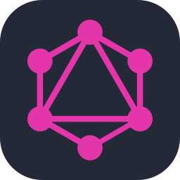
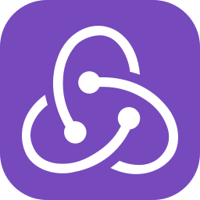
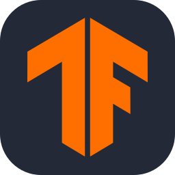
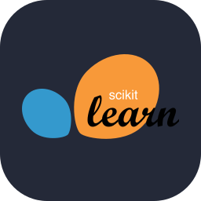
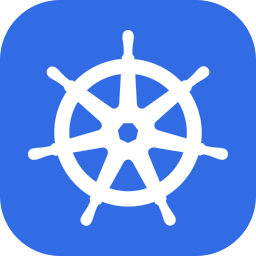
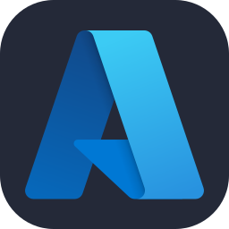
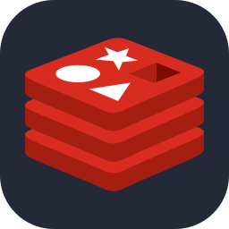

<h1 align="center">Elias Andualem</h1>

  <strong>Senior AI and Full Stack Engineer</strong> 
  AI systems, useful tools, and a few playful experiments.

  <a href="https://www.linkedin.com/in/elias-andualem/">LinkedIn</a> ·
  <a href="mailto:eandualem@gmail.com">Email</a> ·
  <a href="#tools-for-everyday-work">Tools</a> ·
  <a href="#playful-experiments">Experiments</a> ·
  <a href="#technologies">Technologies</a>

I build AI systems from the application interface to the infrastructure underneath. Six years of AI and machine learning work, including enterprise assistants, retrieval systems, MCP integrations and full stack applications. These open source projects explore the same ideas in tools you can run and inspect.

## Tools for everyday work

### Agent Backbone

Terminal coding agents working as a team across Claude Code, Codex and OpenCode. Communication, delegated work and continuity across projects.

Agent coordination · Python · CLI integrations 
[Explore the project](https://github.com/eandualem/agent-backbone) · [Watch the overview · 1:23](https://youtu.be/3gOH3t3woXM) · [Why Backbone · 2:23](https://youtu.be/yKV8RNgqRsE) · [Playlist](https://www.youtube.com/playlist?list=PLMq17WKA4Z88)

### Entune

<a href="https://youtu.be/xiBObz8Ugm8">
  <picture>
    <source media="(prefers-color-scheme: dark)" srcset="https://raw.githubusercontent.com/eandualem/entune/main/docs/brand/entune-logo-dark.svg">
    
  </picture>
</a>

Dictation for macOS, Windows and Linux. Choose a local or cloud speech model, speak into any application, and use a personal dictionary whose corrections consider the sentence.

Speech recognition · Contextual corrections · Desktop applications 
[Explore Entune](https://github.com/eandualem/entune) · [Watch the dictionary demo](https://youtu.be/xiBObz8Ugm8) · [Archived 0.3.0 tour](https://youtu.be/4V297JsJ46U) · [Playlist](https://www.youtube.com/playlist?list=PLYvbVQAyQrzY)

### tmux-workspaces

Group terminals by purpose, name their tabs, keep a split layout in each one, and return to the same arrangement. A workspace layer for the shells and sessions you already run in tmux.

Terminal interfaces · Python · Developer tools 
[Explore tmux-workspaces](https://github.com/eandualem/tmux-workspaces)

## AI inside applications

### Assistant Runtime + Design Studio

**Assistant Runtime** supplies conversations, streaming, voice and tool requests for applications. **Design Studio** shows it in use: an assistant edits Markdown and Mermaid diagrams directly in a document editor, with rendering feedback to help repair diagrams.

Pydantic AI · FastAPI · Socket.IO · Next.js · XState 
[Assistant Runtime](https://github.com/eandualem/assistant-runtime) · [Design Studio](https://github.com/eandualem/design-studio)

**[XState MCP](https://github.com/eandualem/xstate-mcp)** gives coding agents access to a running application's state machines. Inspect actors, context and event history, check which transitions are allowed, and send events through explicit write controls.

## Playful experiments

### Decision Pitch

22 AI players, two managers, one soccer match. Decision models control the players while language models choose lineups and tactics. The match keeps moving while they think.

Decision models · Multi-agent systems · Real-time 3D 
[Explore Decision Pitch](https://github.com/eandualem/decision-pitch)

### Decision Arena

Decision models race through a world that keeps moving while they think. Each model chooses its next move as soon as the previous answer arrives, making both decision quality and response speed visible.

Decision models · Asynchronous inference · Real-time 3D 
[Explore Decision Arena](https://github.com/eandualem/decision-arena) · [Watch a race · 28s](https://youtu.be/zo50Fkto2JQ) · [How it works · 4min](https://youtu.be/dgG4_fvZqdM) · [Playlist](https://www.youtube.com/playlist?list=PLbt997ez0__g)

### Avatar Studio

A voice assistant with a body. Talk to Charlie while separate models handle the conversation and movement, connected through Assistant Runtime.

Voice interaction · Application tools · 3D animation 
[Explore Avatar Studio](https://github.com/eandualem/avatar-studio)

## Technologies

### Languages and backend

  
  
  
  
  
  
  
  

Python · TypeScript · JavaScript · FastAPI · Node.js · GraphQL · Django · Flask

### Web and mobile

  
  
  
  
  
  

React · Next.js · Redux · Vue · Nuxt · XState · Flutter · React Native

### AI and agents

  
  
  

LangChain · LangGraph · MCP · Pydantic AI · Weaviate · PyTorch · TensorFlow · scikit-learn

### Cloud and data

  
  
  
  
  
  
  
  

Docker · Kubernetes · AWS · Azure · Google Cloud · PostgreSQL · Redis · MongoDB
